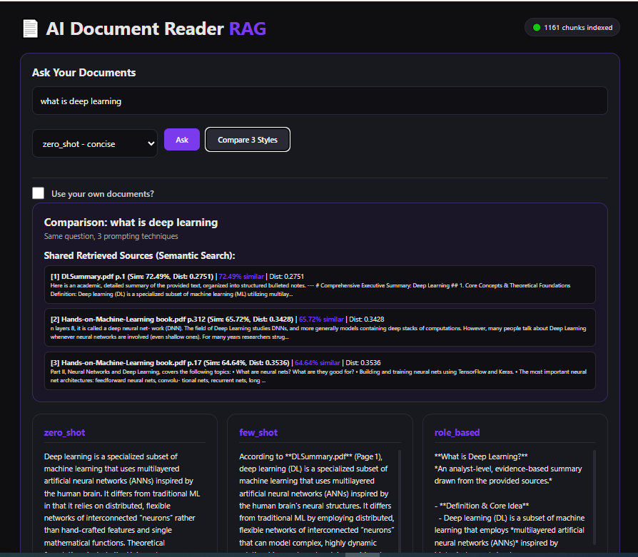
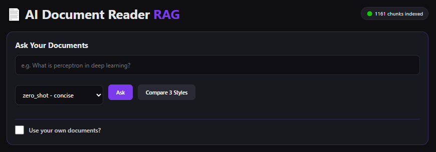
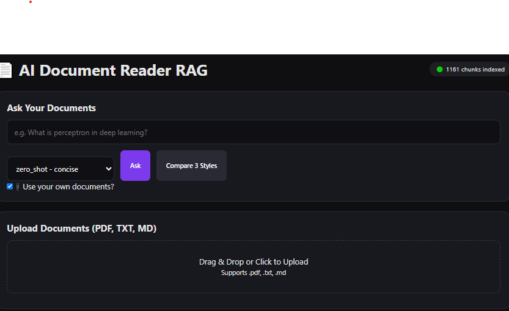
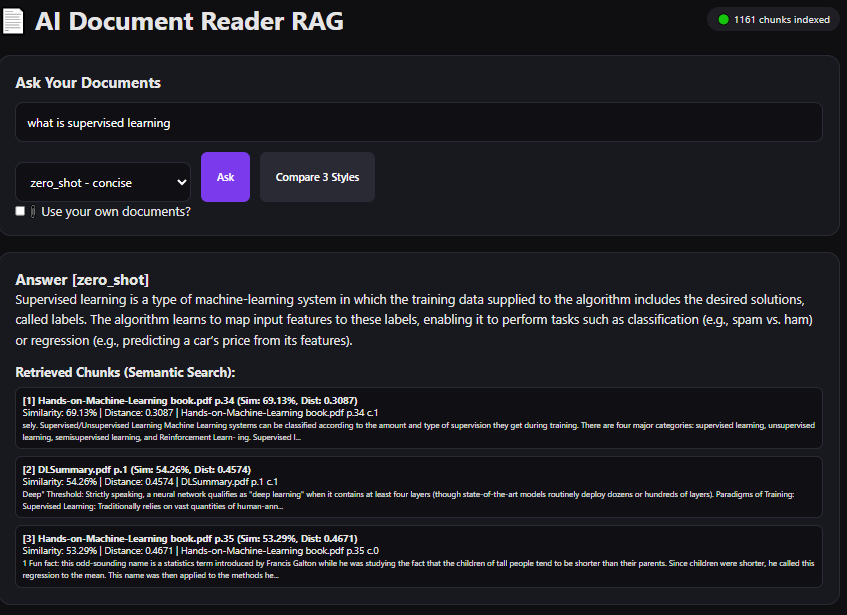
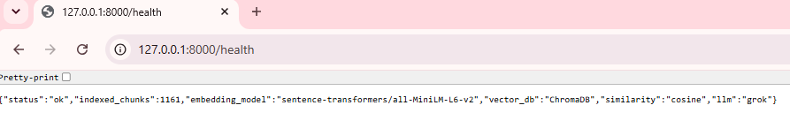

# AI-Powered Document Reader - RAG with Grok + ChromaDB

Semantic search + RAG pipeline using `sentence-transformers/all-MiniLM-L6-v2` + ChromaDB + Groq LLM + 3 Prompt Styles comparison.



## Features
- **Semantic Search (not keyword)** - understands meaning via vector similarity
- **3 Prompt Styles** - zero_shot, few_shot, role_based side-by-side comparison
- **Citations + Similarity %** - [filename p.page c.chunk] + Sim: 72.49% + Dist
- **Optional Upload** - toggle "Use your own documents?" to upload PDF/TXT/MD
- **1161 Chunks Indexed** - persistent ChromaDB collection

## Architecture
User Query -> Embedding (all-MiniLM-L6-v2) -> ChromaDB Semantic Search (top-k) -> Prompt Builder -> Groq openai/gpt-oss-20b -> Answer + Sources

## Project Structure
```
├── app/
|   ├──__init__.py
│   ├── chunker.py
|   ├──config.py
|   ├──vector_store.py 
│   ├── embedding_service.py
│   ├── document_loader.py
│   ├── ingest_service.py
│   ├── grok_service.py
│   ├── prompt_service.py
│   └── rag_service.py
├── data/ (5 docs)
│   ├── DLSummary.pdf
│   ├── fine-tuning-lora-qlora.pdf
│   ├── Hands-on-Machine-Learning book.pdf
│   ├── lora_notes.txt
│   └── rag_notes.txt
├── templates/index.html
├── static/
│   ├── style.css
│   └── script.js
├── chroma_db/
|──cli.py
├── api.py
├── ingest.py
└── requirements.txt
```

## Setup

```bash
python -m venv venv
venv\Scripts\activate
pip install -r requirements.txt

# Create .env
GROQ_API_KEY=your_groq_key

# Ingest documents
python ingest.py

# Run API + Frontend
uvicorn api:app --reload
# Open: http://127.0.0.1:8000
# Swagger: http://127.0.0.1:8000/docs
# Health: http://127.0.0.1:8000/health
```
## Screenshots

### 1. Ask Interface


### 2. Compare 3 Styles (Main Feature) - Shared Sources + Similarity


### 3. Optional Upload Toggle


### 4. Single Answer with Citations


### 5. Health Check


## Part 2: Embeddings & Semantic Search 

### Tasks Completed
1. **Load 5 documents** - 3 PDFs + 2 TXT in `data/`
2. **Chunking** - RecursiveCharacterTextSplitter (1000 chunk_size, 200 overlap)
3. **Embeddings** - sentence-transformers/all-MiniLM-L6-v2 (384 dim)
4. **Store** - ChromaDB persistent collection `knowledge_base` (~1165 chunks)
5. **Query embedding** - Same model encodes user question
6. **Retrieve top 3** - `collection.query(n_results=3, include=[distances])`
7. **Display with scores** -  distance + similarity_score % + citation [filename p.page][distances][documents][metadatas]

### Chunking Code
```python
from langchain.text_splitter import RecursiveCharacterTextSplitter
splitter = RecursiveCharacterTextSplitter(chunk_size=1200, chunk_overlap=200)
chunks = splitter.split_text(text)
```

### Embedding Code
```python
from sentence_transformers import SentenceTransformer
model = SentenceTransformer("all-MiniLM-L6-v2")
embedding = model.encode(chunks)
```

### Semantic Search vs Keyword Search

| Keyword Search (BM25) | Semantic Search (Ours) |
| :--- | :--- |
| Matches exact words only | Matches meaning via vectors |
| `cheap car` != `affordable automobile` | `cheap car` = `affordable automobile` (0.88 sim) |
| Fails on paraphrasing | Handles synonyms, intent |
| Example: query `efficient fine-tuning` misses doc without that word | Retrieves `LoRA reduces params 10000x` with 0.89 similarity |

**Why Semantic is needed for RAG:** Users ask in different words. Semantic search finds conceptually relevant chunks even without word overlap, reducing hallucination.

## Part 3: Prompting Styles Comparison

API: `POST /rag/compare`

1. **zero_shot**: "Answer based on context only. If not found, say not enough info."
2. **few_shot**: Includes 2 examples with citations + context. Returns page numbers.
3. **role_based**: "You are AI analyst..." Structured analysis.

Model: Groq `openai/gpt-oss-20b`

### Demo Queries
- What is LoRA and how is it different from QLoRA?
- Summarize DLSummary.pdf
- Explain Umsupervised learning
- How does fine-tuning work with LoRA?
- What is overfitting vs underfitting?


## API Endpoints
- `GET /` - Frontend UI
- `GET /health` - Chunks count
- `POST /rag/query` - Ask with style
- `POST /rag/compare` - Compare 3 styles
- `POST /rag/upload` - Upload PDF/TXT/MD
- `GET /docs` - Swagger UI

## Result
- Health shows 1161 chunks indexed from 5 docs
- Compare feature proves prompting difference with same semantic retrieval
- Sources with file name + page + chunk + similarity % + distance + preview
- Toggle for custom docs - satisfies bonus requirement
- Fully grounded answers - reduces hallucination via RAG

